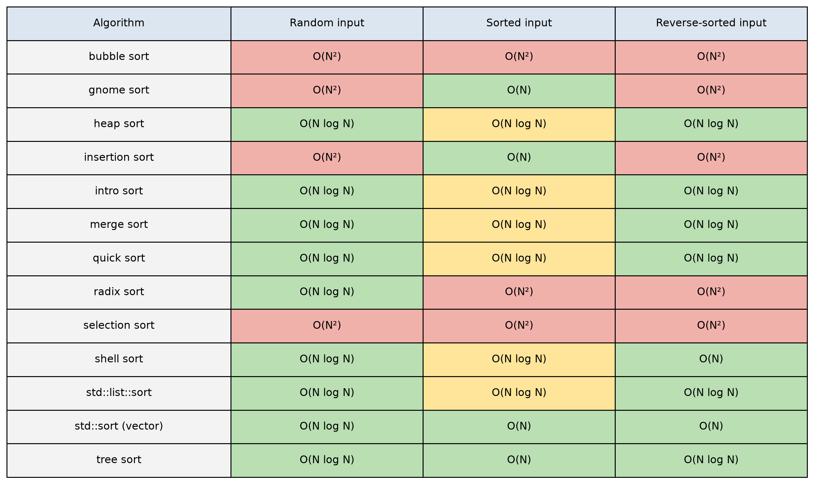
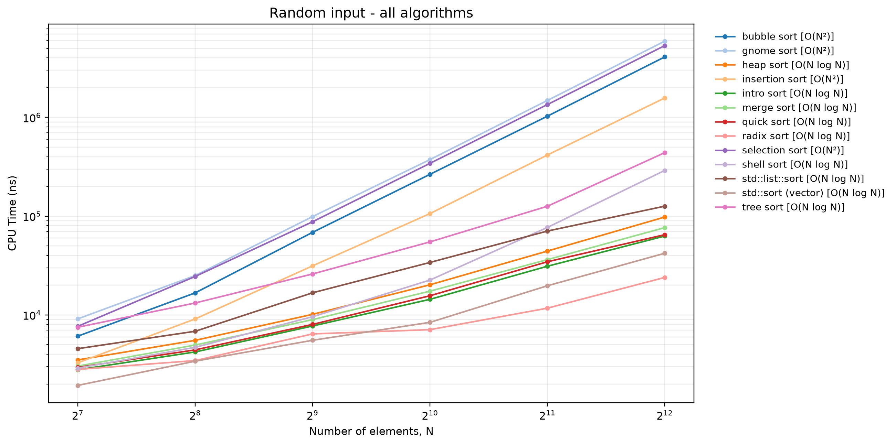

# sort-benchmark

A small C++23 benchmark suite that measures the performance of classic sorting algorithms
using [Google Benchmark](https://github.com/google/benchmark).

The project was created for the **"Algorithm efficiency evaluation"** practical assignment
of the course **"Processing and Analysis of Research Results Using IT"**. Its goal is to
produce reproducible timing data (console, JSON or CSV) that can be analysed further and
compared against the theoretical complexity of each algorithm.

## What is benchmarked

Every algorithm is run on three kinds of input — **random**, **already sorted** and
**reverse-sorted** — starting at 128 elements and doubling each step. Bubble sort,
selection sort, and the random/reverse-sorted variants of gnome and insertion sort
stop at 4 096; most other series reach 65 536, and radix sort reaches 262 144.
Google Benchmark's complexity estimator reports the best-fitting Big-O and RMS error for each series.

| Benchmark prefix   | Algorithm                                   |
|--------------------|---------------------------------------------|
| `bubble_sort`      | Bubble sort                                 |
| `gnome_sort`       | Gnome sort                                  |
| `heap_sort`        | Heap sort                                   |
| `insertion_sort`   | Insertion sort                              |
| `intro_sort`       | Introsort (quick + heap + insertion)        |
| `merge_sort`       | Merge sort                                  |
| `quick_sort`       | Quick sort (iterative, middle pivot)        |
| `radix_sort`       | Radix sort                                  |
| `selection_sort`   | Selection sort                              |
| `shell_sort`       | Shell sort                                  |
| `std_sort_vector`  | `std::sort` on `std::vector`                |
| `std_sort_list`    | `std::list::sort`                           |
| `tree_sort`        | Tree sort via `std::multiset`               |

Each prefix has three variants: `<prefix>_random`, `<prefix>_sorted`, `<prefix>_reverse_sorted`.

## Prerequisites

The CMake presets are written for **Linux only**.

- CMake **4.2** or newer
- [Ninja](https://ninja-build.org/)
- Clang / `clang++` with **libc++** and the **lld** linker (the presets use `-stdlib=libc++ -fuse-ld=lld`)
- libpfm development headers (`libpfm4-dev` on Debian/Ubuntu, `libpfm-devel` on Fedora) — Google Benchmark
  is built with `BENCHMARK_ENABLE_LIBPFM=ON`
- Internet access on the first configure: Google Benchmark v1.9.5 is downloaded via `FetchContent`

## Building

### Quick way

```sh
./build.sh                         # release-linux (default)
./build.sh debug-linux    # debug build
```

The script configures, builds and installs the executable into `./out/`.

### Manual steps

```sh
cmake --preset "release-linux"
cmake --build --preset "release-linux"
cmake --install ./.build/release-linux
```

Replace `release-linux` with `debug-linux` for a debug build.
The resulting binary is `./out/benchmark_tool`.

## Running the benchmark

Run every benchmark (this takes a while — the O(n²) sorts go up to 65 536 elements):

```sh
./out/benchmark_tool
```

List all available benchmarks without running them:

```sh
./out/benchmark_tool --benchmark_list_tests
```

Run only a subset using a regular expression filter:

```sh
./out/benchmark_tool --benchmark_filter="quick_sort*|merge_sort*"
```

### Exporting results

JSON:

```sh
./out/benchmark_tool --benchmark_out=./out/result.json --benchmark_out_format=json
```

CSV:

```sh
./out/benchmark_tool --benchmark_out=./out/result.csv --benchmark_out_format=csv
```

Filters and export can be combined:

```sh
./out/benchmark_tool --benchmark_filter="heap_sort*" --benchmark_out=./out/heap.csv --benchmark_out_format=csv
```

Console output is still printed when exporting to a file.

## Generating report images

Generate the benchmark results and charts with [uv](https://docs.astral.sh/uv/):

```sh
uv run benchmark_report.py
```

It builds and runs the full benchmark suite, then saves the CSV and charts in
`docs/result/`. The full run can take a while.

To regenerate images from the existing CSV without building or measuring:

```sh
uv run benchmark_report.py --plot-only
```

### Example images

Empirical Big-O of each algorithm for Random, Sorted and Reverse-sorted input:



CPU time of all algorithms on random input (log-log scale):



## Example output

```
$ ./out/benchmark_tool --benchmark_filter="quick_sort_random"
Run on (16 X 5263.06 MHz CPU s)
...
------------------------------------------------------------------
Benchmark                        Time             CPU   Iterations
------------------------------------------------------------------
quick_sort_random/128         1581 ns         1566 ns       377805
quick_sort_random/1024       15977 ns        15916 ns        59742
quick_sort_random/8192      404518 ns        403096 ns         1763
quick_sort_random/65536    4137962 ns      4124679 ns          170
quick_sort_random_BigO        3.94 NlgN       3.93 NlgN
quick_sort_random_RMS            1 %             1 %
```

- **Time** — wall-clock time per iteration, **CPU** — CPU time per iteration.
- **Iterations** — how many times the benchmark was repeated to get a stable measurement.
- **`_BigO`** — the complexity class that best fits the measured series (here *N·log N*);
  **`_RMS`** — the fitting error.

## Tips for stable measurements

- Google Benchmark prints `***WARNING*** CPU scaling is enabled` if the CPU frequency governor is
  dynamic. For less noisy numbers switch to the `performance` governor, e.g.
  `sudo cpupower frequency-set --governor performance`.
- Use `--benchmark_repetitions=N` to repeat each benchmark and get mean / median / stddev rows.
- Use `--benchmark_min_time=<n>s` to lengthen individual runs if iteration counts look low.
- Run `./out/benchmark_tool --help` for the full list of Google Benchmark options.
